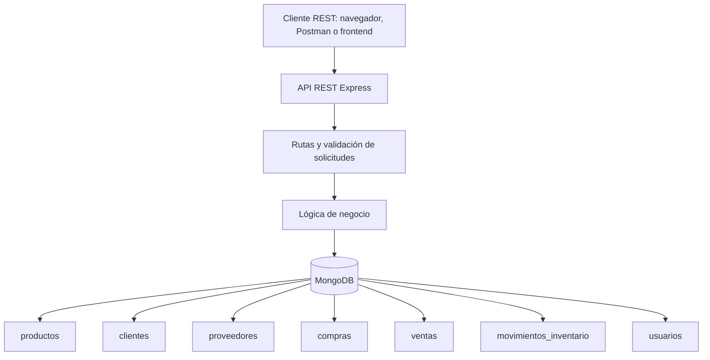

# Arquitectura del sistema

## Capas

- **Cliente REST:** envía solicitudes HTTP y recibe JSON.
- **Express:** declara endpoints y procesa solicitudes.
- **Validación:** verifica parámetros, tipos y campos requeridos.
- **Lógica de negocio:** verifica referencias, calcula importes y aplica reglas de inventario.
- **MongoDB:** almacena documentos, índices y validaciones de colección.

## Flujo de una venta

1. El cliente de la API envía cliente, productos, cantidades y método de pago.
2. Express valida el formato de la solicitud.
3. La lógica de negocio abre una transacción.
4. Se verifica el cliente, la disponibilidad de los productos y el stock.
5. Se calcula el importe con los precios del catálogo.
6. Se descuentan unidades y se registran movimientos y venta.
7. Se confirma la transacción y se devuelve el documento creado.
