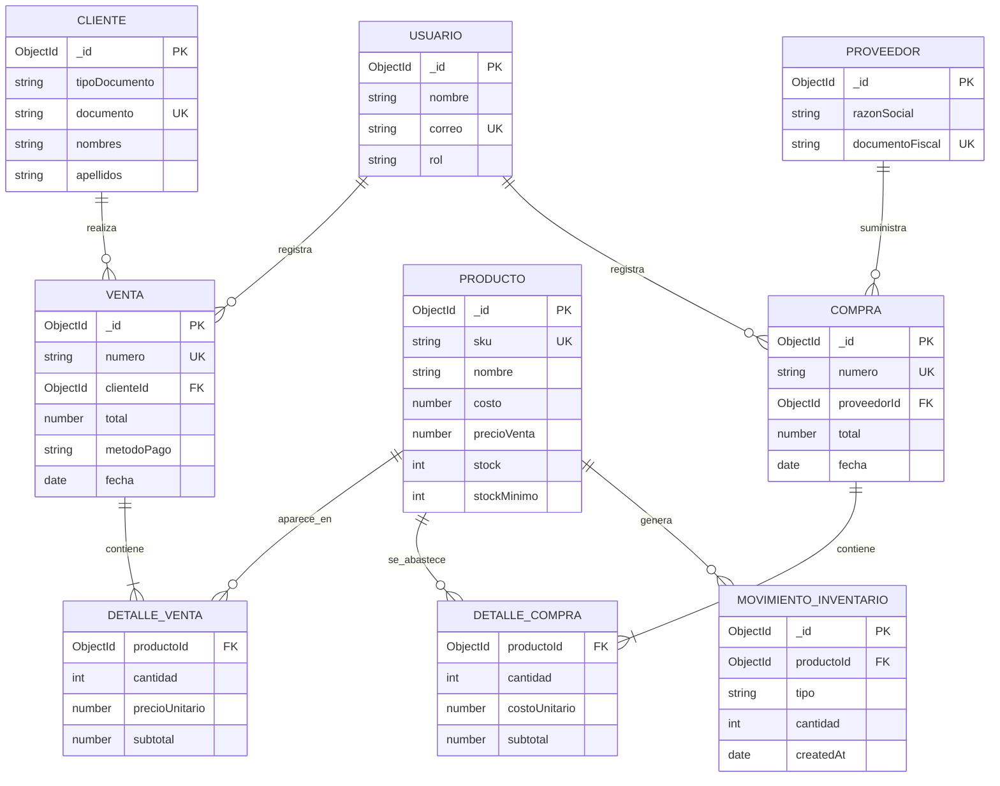

# Diagrama Entidad–Relación (DER) conceptual

MongoDB es una base de datos documental y no exige un esquema relacional. Este DER representa las entidades del negocio a nivel conceptual para mostrar sus relaciones y cardinalidades.

## Lectura del diagrama

- Un cliente puede realizar cero o muchas ventas; cada venta corresponde a un cliente.
- Una venta contiene uno o varios ítems. En MongoDB, el detalle se guarda como un arreglo embebido `items` dentro del documento `ventas`.
- Un proveedor puede asociarse a muchas compras. El detalle de compra también se guarda embebido en `compras.items`.
- Cada compra o venta genera movimientos de inventario por producto.
- Las referencias se almacenan como `ObjectId`; las líneas de venta y compra conservan una instantánea de SKU, nombre y precio/costo para preservar el historial.

**Nota:** `DETALLE_VENTA` y `DETALLE_COMPRA` se muestran como entidades en el DER conceptual, pero no son colecciones independientes en la implementación. Sus documentos embebidos forman parte de `ventas.items` y `compras.items`.
